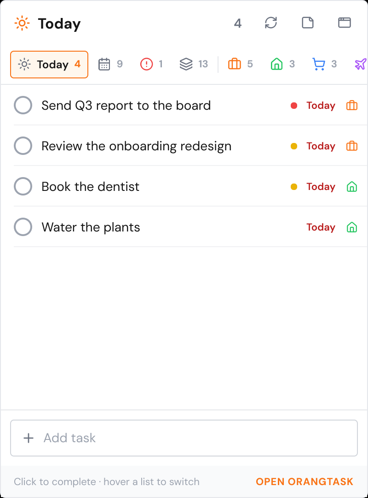
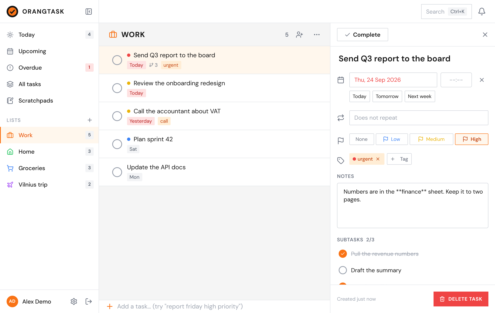

<div align="center">

### OrangTask
A self-hosted task manager with a web app, an Android app and real-time sync<br>
Lists, smart views, sharing, natural language quick-add, offline queue and push<br>

[task.oranges.lt](https://task.oranges.lt)

</div>

---

### What's in here

| Folder      |                    What it is                          |
| ----------- | ------------------------------------------------------ |
| `backend/`  | Bun + Hono + Postgres API, WebSocket sync, web push |
| `frontend/` | React + Vite + Tailwind PWA |
| `android/`  | Native Kotlin app (Jetpack Compose, Room, Hilt) |
| `desktop/`  | Native Linux app (Qt 6 + QML, C++), tray popup and KRunner search |
| `mcp/`      | MCP server so Claude Code can read and edit your tasks |

### Features

- Lists with icons and colors, plus smart views (today, week, overdue, assigned, all)
- Share a list with anyone, roles for owner, editor and viewer
- Quick-add that parses text like `report friday 5pm high priority`
- Recurring tasks via RRULE
- Real-time sync over WebSocket, offline queue that flushes on reconnect
- Web push and native Android push (FCM)
- Command palette, keyboard shortcuts, light and dark themes
- Personal API keys and outgoing webhooks for n8n, Zapier or your own scripts
- Import from Google Keep (Google Takeout export)
- GitHub trackers for issues, pull requests and security alerts, synced into a GitHub list
- Scratchpads for plain notes with basic formatting

### Self-hosting

```bash
git clone https://github.com/Orang-Studio/OrangTask
cd OrangTask
cp backend/.env.example backend/.env
```

Fill in `backend/.env`, at minimum `DATABASE_URL`, `REDIS_URL` and `SESSION_SECRET`.
OAuth, email and push are all optional, the app runs without them.

```bash
docker compose up -d
```

Or run it directly:

```bash
cd backend  && bun install && bun run src/index.ts
cd frontend && bun install && bun run dev
```

`nginx.example.conf` has a reverse proxy config that handles the `/ws` upgrade.

### Android

Open `android/` in Android Studio and run. Android builds include the OrangTask
Firebase configuration and apply the Google Services plugin. All build types
use the `lt.oranges.orangtask` package. The backend needs matching
`FCM_PROJECT_ID`, `FCM_CLIENT_EMAIL` and `FCM_PRIVATE_KEY` credentials to send
native push.

### Desktop (Linux)

`desktop/` is a native Qt 6 client made for KDE Plasma on Wayland. It is not a
web wrapper. It keeps the web app's look and adds the things a browser can't do:

- A tray icon with a live badge. Click it for a small task list:
  - Clicking a task completes it.
  - Hovering a list chip switches lists.
  - A field at the bottom adds a task.
- Middle-click the tray icon, or run `orangtask --quick-add`, to add a task from anywhere.
- Native reminder notifications with Complete and Snooze buttons.
- Search your tasks from KRunner.
- An offline cache and queue.
- Drag and drop capture.
- A scratchpad sticky note.

| Tray popup | Main window |
| --- | --- |
|  |  |

More in [`desktop/screenshots/`](desktop/screenshots/). They are rendered by
`orangtask --screenshots <dir>` from a throwaway demo profile.

```bash
cd desktop
cmake -B build -G Ninja -DCMAKE_INSTALL_PREFIX=/usr
cmake --build build && ctest --test-dir build
sudo cmake --install build
```

Arch users can build `desktop/packaging/arch/PKGBUILD` with `makepkg -si`.
`ORANGTASK_URL` points the app at a self-hosted server (default `https://task.oranges.lt`).

### Translations

Community translations are managed in [Weblate](https://oranges.lt/translate/projects/orangtask/).
English is the source locale for both clients. To pull a published locale into
the web and Android trees:

```bash
cd frontend
WEBLATE_LOCALES=lt npm run i18n:pull
```

### Claude Code integration

`mcp/` is an MCP server that exposes your tasks over the personal API key. See
[mcp/README.md](mcp/README.md) for setup.

### Requirements

- Bun 1.1+ (or Node 18+)
- PostgreSQL 14+
- Redis 6+
- JDK 17 and Android SDK 34 for the Android app
- Qt 6.4+ (Base, Declarative, SVG, WebSockets), CMake 3.21+ and QtKeychain for the desktop app; LayerShellQt optional

<div align="center">

GPL-3.0 licensed<br>
Made with Love ❤️

</div>
